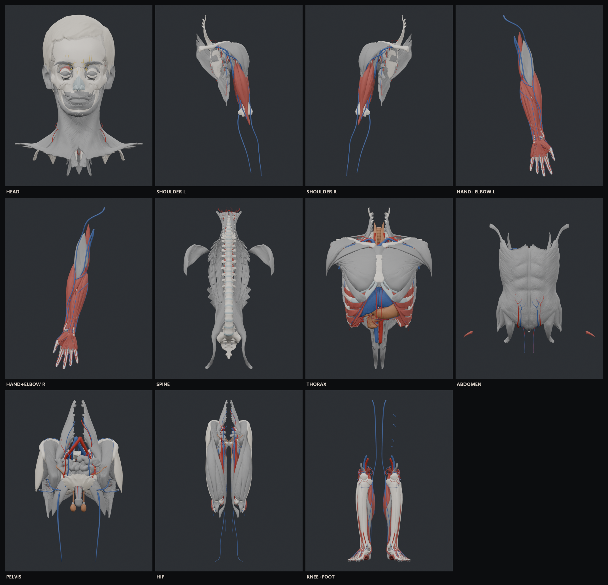

# 人体解剖 3D 模型（GLB，按部位分包）

课堂用的人体解剖三维模型，已从 [BodyParts3D](https://dbarchive.biosciencedbc.jp/en/bodyparts3d/) 的 ISA 数据集
（99% 减面版，2234 个网格）转换、整理、按 11 个部位重新导出为 **glTF 2.0 / GLB**。
不需要安装 Blender，直接把 `glb/` 里的文件丢进你的网页就行。



> 数据来源：BodyParts3D（© ライフサイエンス統合データベースセンター）
> 许可：**CC BY 4.0** —— 可商用、可修改、可再分发，但**必须署名**。
> 署名写法见 [NOTICE.md](NOTICE.md)。

## 里面有什么

| 文件 | 部位 | 部件 | 三角面 | 大小 |
|---|---|---:|---:|---:|
| `glb/head.glb` | 头 | 581 | 1,942,276 | 38.6 MB |
| `glb/shoulder_left.glb` | 左肩 | 42 | 195,690 | 3.7 MB |
| `glb/shoulder_right.glb` | 右肩 | 42 | 192,870 | 3.7 MB |
| `glb/hand_elbow_left.glb` | 左手和肘 | 123 | 227,028 | 4.7 MB |
| `glb/hand_elbow_right.glb` | 右手和肘 | 125 | 227,322 | 4.8 MB |
| `glb/spine.glb` | 脊柱 | 139 | 420,936 | 10.1 MB |
| `glb/thorax.glb` | 胸 | 822 | 2,298,674 | 51.7 MB |
| `glb/abdomen.glb` | 腹 | 334 | 914,266 | 19.2 MB |
| `glb/pelvis.glb` | 骨盆 | 147 | 324,228 | 6.6 MB |
| `glb/hip.glb` | 髋 | 137 | 509,430 | 9.7 MB |
| `glb/knee_foot.glb` | 膝和足 | 226 | 657,022 | 12.8 MB |
| `glb/skin_body.glb` | 整体皮肤 | 1 | 203,382 | 4.7 MB |

合计 **12 个文件 / 170 MB / 8.15 M 三角**。2234 个原始网格全部有归属；
446 个网格跨部位（膈、主动脉、髂血管、腋血管等），所以会在多个文件里同时出现——这是故意的。

`previews/` 里是每个部位的正位渲染图，`catalog.json` 是机读目录。

## 模型约定

- **单位：米**（人体高约 1.70）。Y 轴向上；原点在足底高度附近（最低点约 −0.07，最高点约 1.65），
  即模型是"站在 y≈0 平面上"的。原始数据为 Z-up、毫米，导出时已转换。
- 每个解剖结构 = 一个 mesh 节点，**节点名是解剖学英文名**，例如 `left radius`、`abdominal aorta`。
- 材质按组织上色：肌肉暗红、骨浅米、动脉亮红、静脉蓝、脏器棕、软骨灰蓝、神经黄、筋膜米白。
- 节点 `extras` 里带了元数据，写交互时很有用：

| extras 字段 | 含义 |
|---|---|
| `bp3d_id` | 原始元素 id，如 `FJ1932` |
| `bp3d_group` | `muscle` / `bone` / `artery` / `vein` / `organ` / `cartilage` / `nerve` / `fascia` / `other` |
| `bp3d_fma` | FMA 本体 id |
| `bp3d_cats` | 该网格所属的全部部位 |
| `bp3d_envelope` | 值为 `"1"` 时是"区域包络"（解剖学区、肌群外壳），共 126 个，**挡视线时按这个字段隐藏** |

## 怎么用

### 1. 加载（three.js）

```html
<script type="importmap">
{ "imports": {
    "three": "https://cdn.jsdelivr.net/npm/three@0.160.0/build/three.module.js",
    "three/addons/": "https://cdn.jsdelivr.net/npm/three@0.160.0/examples/jsm/"
} }
</script>
<script type="module">
import * as THREE from 'three';
import { GLTFLoader } from 'three/addons/loaders/GLTFLoader.js';
import { OrbitControls } from 'three/addons/controls/OrbitControls.js';

const loader = new GLTFLoader();
const gltf = await loader.loadAsync('./glb/thorax.glb');   // 换成你要的部位
scene.add(gltf.scene);

// 按组织筛选：只留骨骼和血管
gltf.scene.traverse((o) => {
  if (!o.isMesh) return;
  const g = o.userData.bp3d_group;
  o.visible = (g === 'bone' || g === 'artery' || g === 'vein');
});
</script>
```

### 2. 关键：`file://` 打不开本地 glb

浏览器会拦住 `file://` 页面对本地文件的 `fetch`。两种解决办法：

```powershell
# A. 本地起一个静态服务器（推荐，一次下载反复用）
cd 你的仓库目录
python -m http.server 8000     # 然后访问 http://localhost:8000/example/viewer.html
```

```js
// B. 小文件可以转成 base64 内嵌进 HTML（>10 MB 不建议）
```

`example/viewer.html` 是个 248 行的最小可运行示例：支持 `?model=thorax` 切部位、
按组织显隐、自动取景，可以直接当起点改。

```powershell
# 在仓库根目录
python -m http.server 8000
# 打开 http://localhost:8000/example/viewer.html
```

### 3. 别一次全加载

`thorax.glb` 51 MB，四个文件加起来就超过 100 MB 了。建议：

- 页面默认只加载 1–2 个部位，其余按需 `loadAsync`；
- 加载时给进度条（`loader.load(url, onProgress)` 的 `loaded/total`）；
- 需要低配设备支持再考虑 Draco 压缩版。

## 已知取舍

- ISA 数据集**没有肺、没有上肢神经**（正中神经、尺神经等），所以胸腔包里没有肺，手臂包里没有神经。
- 上臂（肱二头肌/肱三头肌/肱肌）归在 `shoulder_*.glb`，因为分类里没有"上臂"这一档。
- 左右按几何坐标判定，不依赖名称——数据集里有两个拇指肌的 left/right 是互换的。
- 没有 UV、没有贴图，纯几何 + 纯色材质。

## 重新生成

这些 GLB 是用 Blender 5.2 从 BodyParts3D 的 ISA 包批量转换的：解析 2234 个 OBJ →
按解剖区域分类 → 统一样式导出。需要改分类或重新导出时，用同一套脚本重跑即可
（`extract_all.mjs` → `census.mjs` → `classify.mjs` → `full_body.py` → `verify_glbs.mjs`）。

## 许可

模型：CC BY 4.0，署名见 [NOTICE.md](NOTICE.md)。

> BodyParts3D © ライフサイエンス統合データベースセンター licensed under CC BY 4.0
